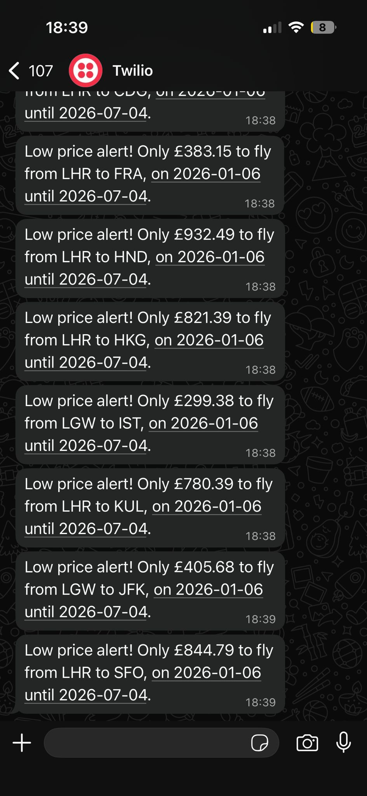

# Flight Deal Finder ✈️

## 🇺🇸 [English] Project Overview

A Python-based flight search tool that tracks flight prices and sends notifications when a deal is found. It uses Google Sheets (via Sheety) to manage destinations and Amadeus API for real-time flight data.

### 🚀 Features
- **Dynamic Destination Management**: Uses Google Sheets to store and manage target cities and price thresholds (see `Flight Deals.xlsx` for template).
- **Automated IATA Lookup**: Automatically finds and fills missing IATA codes for cities in the sheet.
- **Smart Search**: Searches for flights within a 6-month window.
- **Price Alerts**: Sends notifications via WhatsApp (using Twilio) when a price lower than the threshold is found.



### 🛠️ Setup Instructions
1. **Requirements**: Python 3.x, Sheety API, Amadeus API, Twilio.
2. **Installation**:
   ```bash
   pip install -r requirements.txt
   ```
3. **Environment Variables**: Create a `.env` file (refer to `.env.example`).
4. **Usage**: `python main.py`

---

## 🇹🇷 [Turkish] Proje Özeti

Bu uygulama, uçak bileti fiyatlarını takip eden ve belirlediğiniz fiyatların altına düştüğünde size WhatsApp üzerinden bildirim gönderen bir Python aracıdır. Verileri yönetmek için Google Sheets (Sheety), uçuş aramaları için Amadeus API ve bildirimler için Twilio kullanır.

### 🚀 Özellikler
- **Dinamik Hedef Yönetimi**: Google Sheets üzerinden hedef şehirleri ve fiyat limitlerini yönetir (`Flight Deals.xlsx` dosyasını şablon olarak görebilirsiniz).
- **Otomatik IATA Kodu Bulma**: Eksik şehir kodlarını Amadeus API kullanarak otomatik tamamlar.
- **Akıllı Arama**: 6 aylık bir pencerede en uygun uçuşları arar.
- **Fiyat Uyarıları**: Eşik değerin altında bir fiyat bulunduğunda WhatsApp üzerinden anlık bildirim gönderir.


### 🛠️ Kurulum Talimatları
1. **Gereksinimler**: Python 3.x, Sheety API, Amadeus API, Twilio.
2. **Kurulum**:
   ```bash
   pip install -r requirements.txt
   ```
3. **Çevresel Değişkenler**: `.env` dosyası oluşturun (`.env.example` dosyasını örnek alın).
4. **Çalıştırma**: `python main.py`

## 📄 License
MIT License
